# Geiranger – Sieben Schwestern und elf Kehren

Der Geirangerfjord als 3D-Echtzeitszene: rund 20 km Wasser zwischen Wänden aus Gneis bis 1 700 m, die Sieben Schwestern und gegenüber der Freier (Friaren), am Ende des Fjords der Ort Geiranger auf dem Delta der Geirangelva und darüber die Fv63 in elf Kehren bis zur Plattform der Ørnesvingen. Die Fähre aus Hellesylt fährt nach dem Fahrplan und lässt vor den Schwestern das Horn hören, das Echo kommt von den Wänden zurück. Busse halten an der Plattform, Gäste schauen über das Geländer. Das Jahr läuft mit Schnee in zehn Höhenstufen, Eis an den Fällen und Herbstlaub. Das Gelände kommt aus den HGT-Kacheln mit 1″ („DEM1“), die Feinform der Wände aus `cliff`, der Fjordgrund ist gemalt.

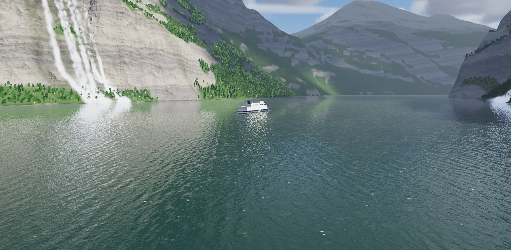

Geiranger ist die Fortsetzung von Rungholt und Glacier. Die Element-Packages kommen fertig aus `lib/Renderer.jar` (F4 A). Neu entstanden sind hier zwei, die jede Gebirgsszene brauchen kann: `fall` (Wasserfälle) und `cliff` (Steilwand als Material und Feinform). Seit Phase 18 liegen auch sie in `Renderer.jar`, ihre Quellen in `pakete/`. Jedes Package folgt demselben Vertrag: Der Kern braucht nur Java 21, `gl/` dazu JOGL, `demo/` dazu FStyle; `check-packages` übersetzt jedes einzeln.

**Stand: Phase 18 von 18, Schliff.** Die Szene hat Gelände, Fjord und Himmel mit Wetter, Fels, Wasserfälle, die Geirangelva mit dem Storfossen, die Ørnesvingen mit Verkehr, Wald, Wiesen und Höfe, den Ort, Schiffe mit Kielwasser, Menschen, das Jahr, Klang mit dem Echo der Wände, drei Regiebücher mit Kino und die Datenbank (Schema GR_ oder Dateien in `daten/`; Einrichten, Prüfen und QGIS in [db/README.md](db/README.md)). Dazu kommen jetzt der Dauerlauf, die Verknüpfung mit Symbol, die Quellenliste und die Qualitätsstufen für alle Teile. Plan und Fortschritt stehen im Artefakt „Geiranger Werkbuch“, die Statusbilder in `docs/status/`.

## Bilder

| | |
|---|---|
| 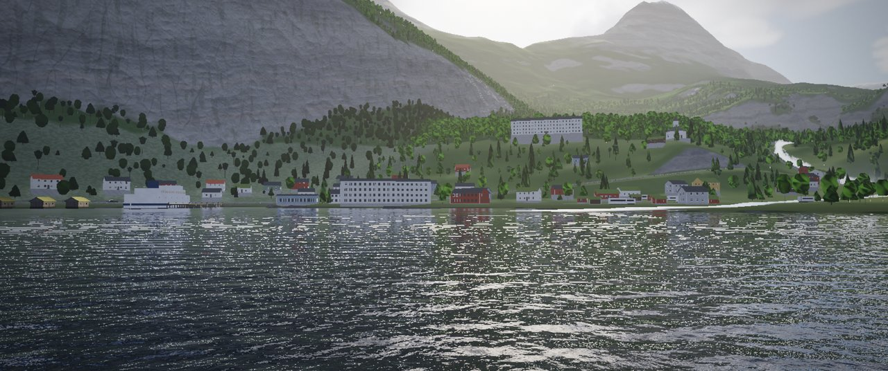 | 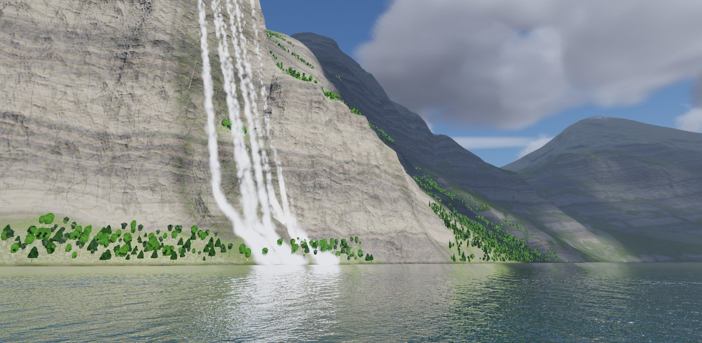 |
| Der Ort vom Wasser (Kino, „Mit der Fähre von Hellesylt“) | Die Sieben Schwestern unter dem Hof Knivsflå |
| 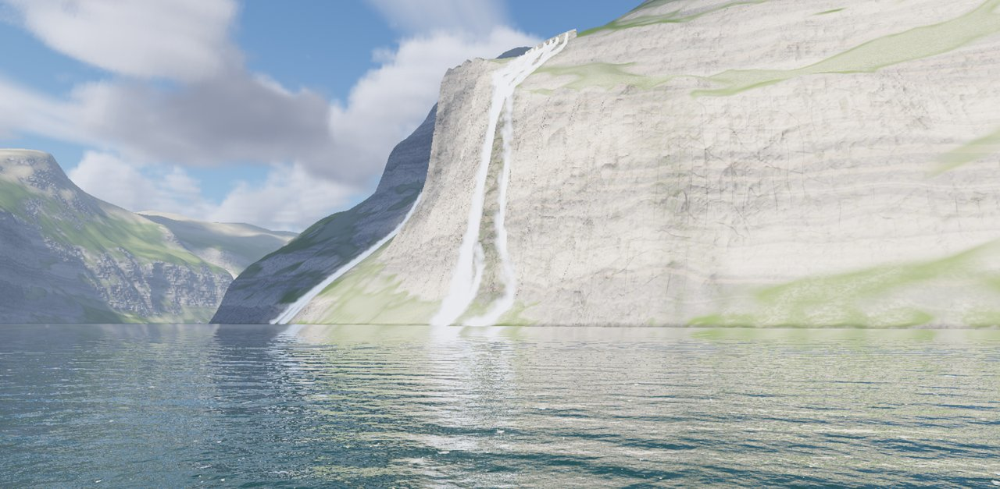 | 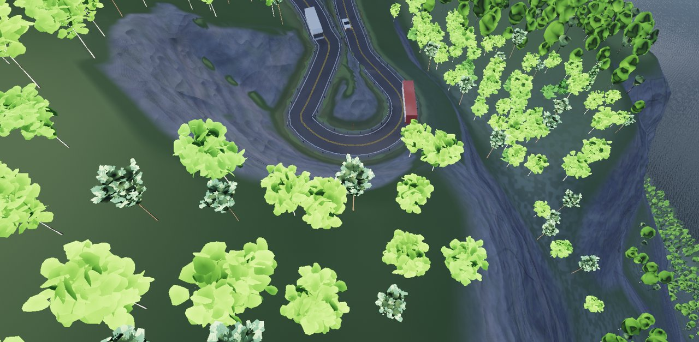 |
| Die Schwestern vom Wasser, Wand aus `cliff`, Fälle aus `fall` | Ørnesvingen: ein Bus in der Kehre, der Gegenverkehr wartet |
| 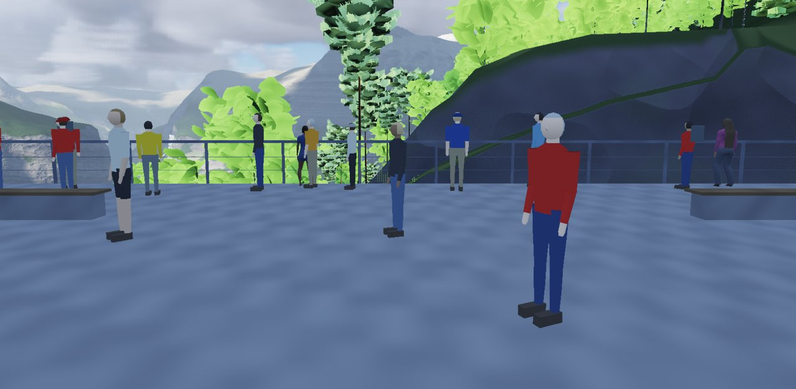 | 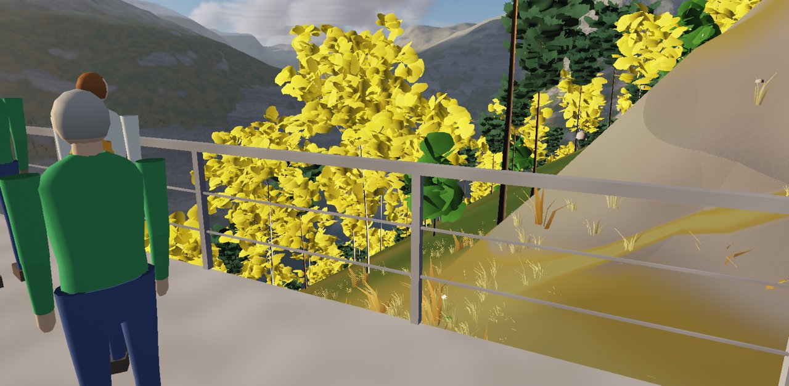 |
| Die Plattform der Ørnesvingen um 11:15 mit Gästen und Busgruppe | Dieselbe Plattform am 15. Oktober: Herbstlaub |
| 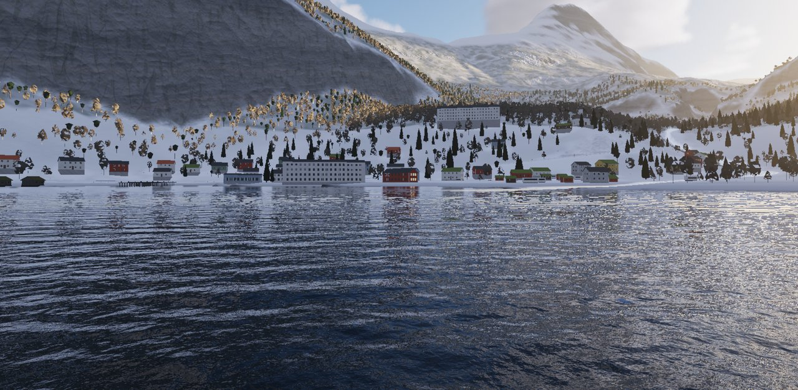 | 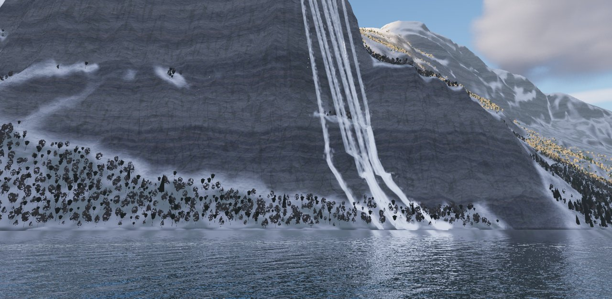 |
| Der Ort am 15. Februar: Schnee in zehn Höhenstufen | Die Schwestern am 15. Februar: die Strähnen frieren |
| 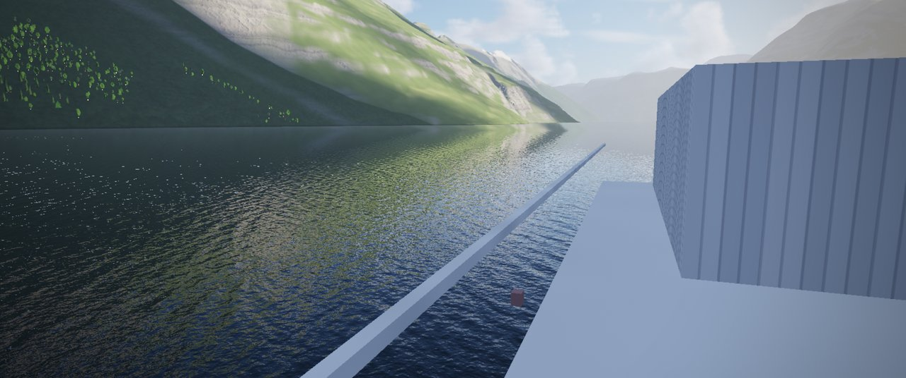 | 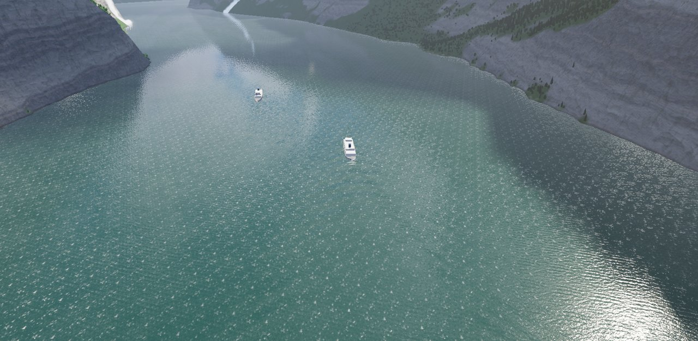 |
| An Bord der MF Bolsøy (Kino) | Das Kielwasser der Fähre läuft an die Ufer |
| 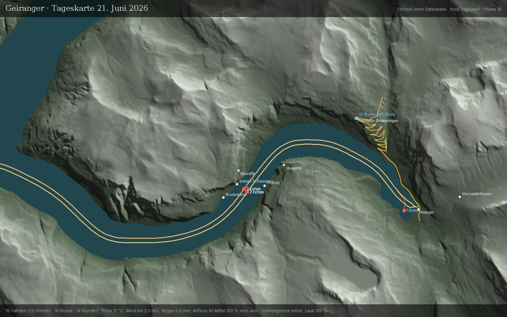 | |
| Die Tageskarte des 21. Juni aus der Chronik: Fahrten, Hörner mit Echos, Busse | |

Die Bilder aus der Szene stammen von einer AMD Radeon 680M auf „Mittel“ (Statusbilder der Phasen 7 bis 16, ohne HUD).

## Die Packages

| Package | Inhalt | Stand |
|---|---|---|
| `com.dan.fall` | Wasserfälle: Abriss, freier Fall, Lauf über Fels, Strähnen, Schleier, Tosbecken, Eis | neu: Engine seit Phase 6, Lauf über Fels seit Phase 7; seit Phase 18 in `Renderer.jar`, Quellen in `pakete/` ([README](pakete/com/dan/fall/README.md)) |
| `com.dan.cliff` | Steilwand: Gneis nach Neigung, Bänder, Klüfte, Nässe, Feinform, Überhänge | neu: Engine seit Phase 5; seit Phase 18 in `Renderer.jar`, Quellen in `pakete/` ([README](pakete/com/dan/cliff/README.md)) |
| `com.dan.sky`, `cloud`, `weather`, `rain`, `fog` | Himmel und Wetter | aus `Renderer.jar`, seit Phase 4; Klima „Geiranger“ mit drei Wetterbüchern |
| `com.dan.ocean`, `wave`, `spray`, `buoyancy` | Fjord, Kielwasser, Schwimmen | seit Phase 3 (Preset „Fjord“), Phase 12 (Schiffe, lange Welle für das Kielwasser) |
| `com.dan.river`, `road`, `forest`, `ground`, `timber` | Elva, Fv63 mit Verkehr, Wald, Bodendecke, Holzbauten | seit Phase 8 bis 11 (Biom „Vestland“, Naust, Anleger, Höfe) |
| `com.dan.figure`, `season`, `soundscape`, `kino`, `store` | Menschen, Jahr, Klang, Kinomodus, Datenseite | seit Phase 13 bis 17 |
| `com.dan.geiranger` | Die App | Phase 18 |

`Renderer.jar` steht im Klassenpfad vor `FStyle.jar`, das ältere Kopien von `road`, `river`, `forest` und `ground` enthält. Nach einer Änderung in `pakete/` frischt das Ant-Target `renderer-jar` `lib/Renderer.jar` auf.

## Bauen und starten

- NetBeans-Projekt mit Ant, JDK 21. In `lib/`: `Renderer.jar`, JOGL mit Windows-Natives, `FStyle.jar`, `Avatar.jar`, `ojdbc11.jar`, `sdo*.jar`.
- **Clean and Build** erzeugt `dist/Geiranger.jar` mit `dist/lib`. Danach startet [Geiranger.bat](Geiranger.bat) die App ohne NetBeans, [Geiranger_Konsole.bat](Geiranger_Konsole.bat) mit Konsole. In NetBeans: **Run**.
- **Verknüpfung:** [Geiranger_Verknuepfung.bat](Geiranger_Verknuepfung.bat) legt „Geiranger“ mit dem Symbol `Geiranger.ico` (der Blick den Fjord hinab, die Schwestern an der Wand, der Abendhimmel im Wasser, Goldkante) auf den Desktop und ins Startmenü. Das Symbol malt `ui.AppIcon`; `ant symbol` schreibt die PNGs ins Jar und das ICO neu.
- Voraussetzung: OpenGL 4.3 mit Compute-Shadern. Ziel (F22 A): AMD Radeon 680M (2 GB), „Mittel“ hält 60 Bilder/s in Full HD.
- **Startbild:** „Neu“, „Weiter wie zuletzt“ (stellt die letzte Sitzung her), „Einrichten“ (Schema GR_, endet mit „alles in Ordnung“), „Ohne Datenbank“ (dann `daten/`), ein Regiebuch „Im Kino“.
- **Prüfung:** `ant pruefung` endet mit „ERGEBNIS: alles in Ordnung“; `check-packages` übersetzt `fall` und `cliff` einzeln; `ant dbpruefung` (oder `DbPruefung` mit Run File) prüft gegen die Datenbank und endet mit „Alles in Ordnung.“
- **Dauerlauf** (Abnahme „fertig“): Block TECHNIK → „Dauerlauf 30 min“ oder Start mit `-Dgeiranger.dauerlauf=30`. Jede Runde spielt „Ein Junitag“ im Kino, zwei Tage frei im Zeitraffer 360 (15. Februar mit Schnee und Eis, 15. Oktober mit einer Front), „Mit der Fähre von Hellesylt“ und „Fahrt über die Ørnesvingen“ im Kino; mindestens zwei Runden. Am Ende `docs/status/Dauerlauf_….png` und `.txt` mit dem Urteil: keine Fehler, jede Runde vollständig, im Mittel 30 Bilder/s, kein Leck (Speicher und Fäden am Ende jeder Runde), Grenzen der Szene (Gäste, Fahrzeuge), Physik nachgekommen, Chronik schrieb mit. Esc beendet nur das Kino, „Abbrechen“ den Dauerlauf.
- **Tasten:** F1 zeigt alle. Maus ziehen dreht und verschiebt, Rad zoomt, W A S D gleitet, F fliegt frei, R kreist, 1 bis 9 die Ansichten, G Grund zeigen, H das HUD, V merkt die Ansicht, Umschalt + Klick setzt einen Merkpunkt, F11 nur die Szene, F12 ein Foto nach `docs/status/`.

### Statusbilder und Werkzeuge (Ant-Targets)

| Target | Phase | Was es schreibt |
|---|---|---|
| `gelaende`, `fjordprofil` | 2, 3 | `daten/gelaende/` aus den HGT-Kacheln, `Gelaende_Import.png`, `Fjordprofil.png` |
| `tempo`, `cliffdemo`, `falldemo` | 5, 6 | Wand der Schwestern von Skageflå, Vorführungen von `cliff` und `fall` (läuft `FallCheck`) |
| `faelle`, `elva`, `kehren` | 7–9 | die Fälle vom Wasser, der Storfossen von der Treppe, die Plattform und der Bus in der Kehre |
| `wald`, `ort`, `schiffe`, `menschen` | 10–13 | Hänge und Höfe, der Ort bei Tag und Nacht, Fähre, Kielwasser und Kreuzfahrtschiff, Gäste und Busgruppe |
| `jahr`, `klang`, `regie` | 14–16 | Plattform im Februar, Mai, Juni, Oktober; Fahrt mit Horn und Echo (Bild und WAV); die drei Regiebücher mit Blatt und im Kino |
| `startdaten`, `dbpruefung`, `daten` | 17 | `db/sql/04_startdaten.sql` aus dem Code; Prüfung gegen Oracle; Tageskarte (`Status_Phase17.png`) |
| `symbol`, `quellen`, `renderer-jar` | 18 | Programmsymbol und `Geiranger.ico`; `docs/QUELLEN.md`; `fall` und `cliff` aus `pakete/` nach `lib/Renderer.jar` |

`tools.Tempo` rechnet Standbilder ohne Fenster; Schalter wie `-Dkamera=x,z,Richtung,Neigung,Höhe`, `-Dregie=Junitag|Ornesvingen|Faehre`, `-Dkino=1`, `-Dmenschen=…`, `-Dschiff=…` stehen in den Targets.

## Qualitätsstufen

Die Stufe im Block SZENE gilt für alle Teile, seit Phase 18 auch für die Höfe aus `timber`, die Fv63 mit ihrem Verkehr, die Menschen, das Kielwasser und den Schneefall. „Mittel“ hält 60 Bilder/s in Full HD auf der Radeon 680M, „Hoch“ und „Ultra“ sind für Standbilder und Kino.

| Stufe | Auflösung | Budget | Gelände (Kern / sonst) | Wasser (FFT × Kaskaden) | Spiegelbild | Wandschatten | Fels, Fälle | Wald | Bodendecke | Höfe | Fv63 / Fahrzeuge | Menschen ab | Kielwasser | Schneeflocken |
|---|---|---|---|---|---|---|---|---|---|---|---|---|---|---|
| Niedrig | 67 % | 8 ms | 4 m / 16 m | 128² × 3 | 35 % | 512² | niedrig | 1,1 km | 10 m | niedrig | 1,5 / 0,7 km | 4 px | aus | 35 % |
| Mittel | 85 % | 16 ms | 2 m / 8 m | 256² × 3 | 50 % | 1 024² | mittel | 1,8 km | 16 m | mittel | 2,5 / 1,2 km | 2,5 px | an | 60 % |
| Hoch | 100 % | 32 ms | 2 m / 8 m | 256² × 4 | 50 % | 1 024² | hoch | 2,5 km | 24 m | hoch | 3,5 / 1,8 km | 1,8 px | an | 100 % |
| Ultra | 100 % | 50 ms | 2 m / 4 m | 512² × 4 | 75 % | 2 048² | ultra | 3,2 km | 32 m | ultra | 5,0 / 2,5 km | 1,2 px | an | 100 % |

Fest bleiben der Klang (Abtastrate beim Start), die Geirangelva (ihr Netz ist klein) und das Echo der Wände. Wird die Grafikkarte langsamer als das Budget, sinkt die Auflösung, nie unter 50 %.

## Raum

UTM Zone 32 Nord (EPSG:25832), Ursprung am Fähranleger in Geiranger [G] bei E 406 330, N 6 886 760: x nach Osten, z nach Süden (Nord = −z), y über NN. Kern West 3 × 2 km (Knivsflå, Sieben Schwestern, Friaren, Skageflå), Kern Ost 2,3 × 3,55 km (Ort bis Møllsæter mit den Kehren), die Umgebung rund 18,8 × 17,4 km. In der Datenbank liegt alles in Länge und Breite (SRID 8307). Die Sieben Schwestern stehen an der steilsten Stelle des Nordufers unter Knivsflå (Kante auf 408 m), die Kanten aller Fälle sucht `scene.Faelle` die Falllinie hinauf.

## Daten

`templates/` (nicht im Git) hält Karte, Fotos, die HGT-Kacheln `N62E006` und `N62E007`, den GLO-30-Zuschnitt und die Scan-Assets. `daten/gelaende/` (12,6 MB, im Git) ist das importierte Gelände: `hoehe.r16` (2048² zu 12 m, im Fjord der gemalte Grund), `fern.r16` (512² zu 120 m), `art.u8`, `gelaende.properties`. Ohne Datenbank schreibt die App Sitzungen, Chronik (CSV), Merkpunkte, Ansichten, Presets und eigene Regiebücher nach `daten/`; „Übernehmen“ im Block DATEN bringt sie später in die Datenbank.

## Quellen

Alle Quellen und Befunde (belegt, gemessen, gestaltet [G]) stehen in [docs/QUELLEN.md](docs/QUELLEN.md), erzeugt von `tools.Quellenliste` aus denselben Dateien wie die Startdaten der Datenbank: 10 Quellen, 25 Befunde, die Vorlagen in `templates/` und die Bibliotheken.
